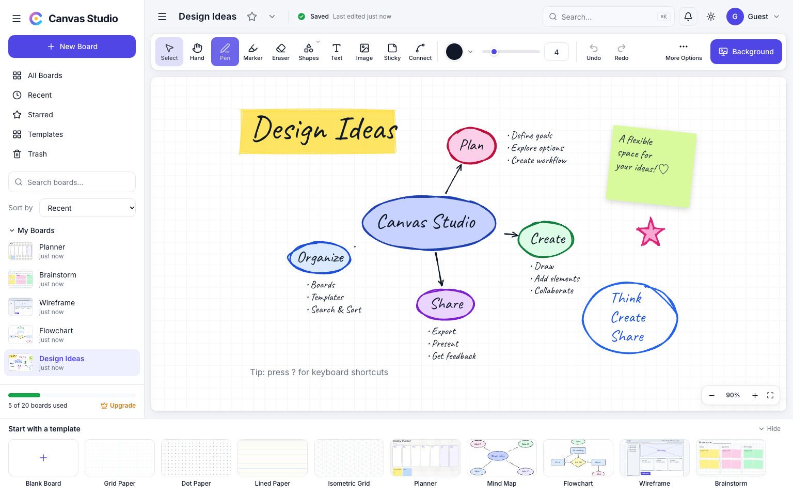
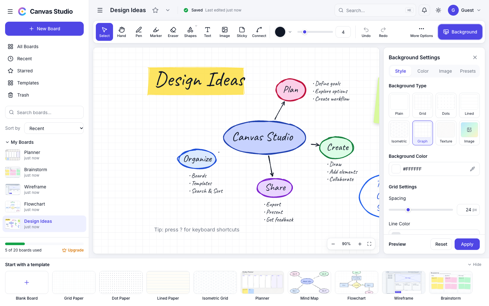
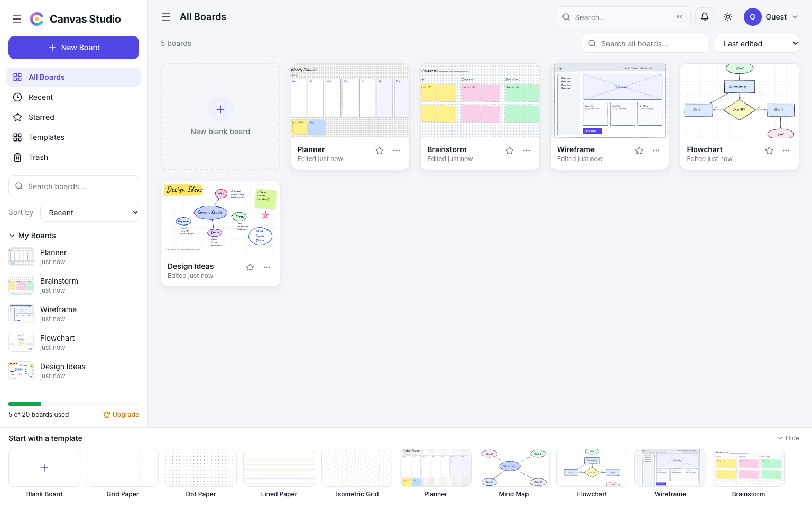
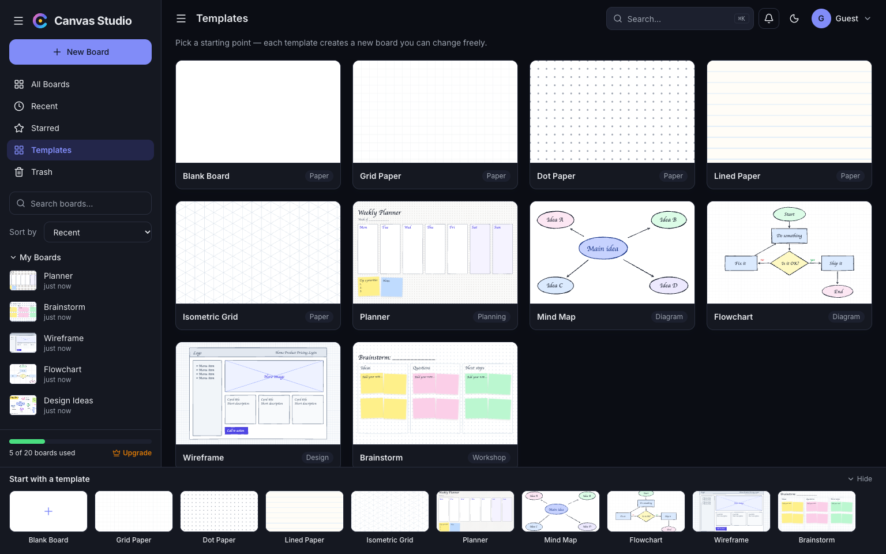
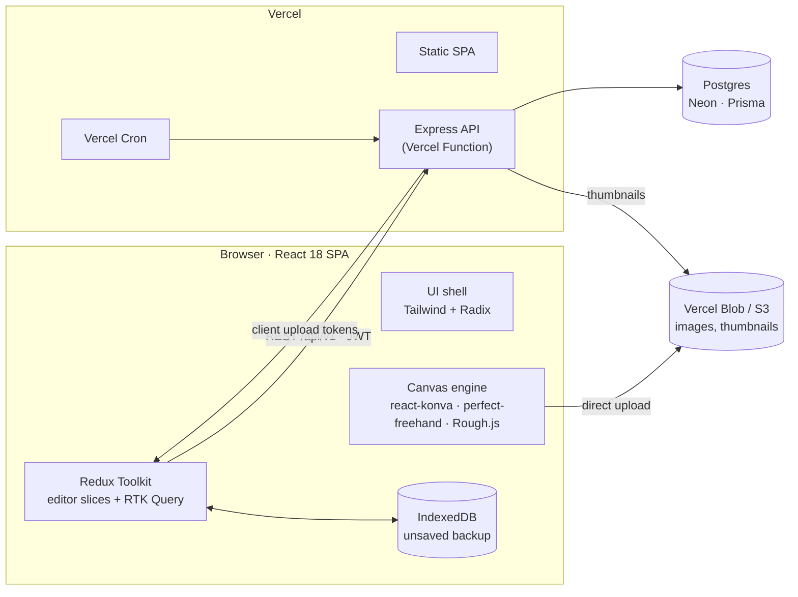

<div align="center">

# Canvas Studio

**A flexible space for your ideas: think, create, share.**

An infinite whiteboard with a hand-drawn feel for sketching, mind-mapping and planning, with grids and templates when you need structure.

[**Live demo**](#live-demo) · [Features](#features) · [Quick start](#quick-start) · [Deploy](#deploy-to-vercel) · [Architecture](#architecture)




</div>

## Live demo

Hosted on Vercel at **https://canvas-studio-tau.vercel.app**. There's no sign-up: the app opens straight to your boards, and each browser gets its own private workspace.

## Features

### Drawing and canvas
- **Infinite canvas.** Pan with scroll, Space+drag or the Hand tool; zoom from 10% to 400% with ⌘/Ctrl + scroll or a trackpad pinch.
- **Pen with pressure.** Uses [perfect-freehand](https://github.com/steveruizok/perfect-freehand), with real stylus pressure where available. There's also a highlighter-style **Marker**.
- **Shapes:** rectangle, ellipse, triangle, diamond, star, line and arrow, in either a **hand-drawn** ([Rough.js](https://roughjs.com)) or clean style.
- **Text** in handwritten (Caveat) or sans (Inter) fonts, edited inline. **Sticky notes** in six colours.
- **Images:** upload, drag and drop, or paste. Images are resized in the browser to 2560 px or less.
- **Connectors** that stay attached as shapes move.
- **Selection:** click, marquee or shift-click; move, resize and rotate. Duplicate, delete, group, lock, and change layer order.
- **Editing:** stroke eraser, 50-step undo/redo, copy/paste (including between boards), snap to grid, keyboard shortcuts (press `?`).

### Backgrounds
Plain, Grid, Dots, Lined, Isometric, Graph, Texture and Image (cover or tile). You can set the background colour (hex input plus eyedropper) and the grid spacing, line colour, width and opacity. Changes preview live and only stick when you press **Apply**. Eight presets are included, among them Blueprint, Notebook and Chalkboard.



### Boards and templates
- **Dashboard views:** All, Recent, Starred and Trash, with server-side search and sorting. Thumbnails are generated automatically.
- **Board actions:** rename, duplicate, star, and move to Trash. Trashed boards are purged automatically after 30 days.
- **10 templates:** Blank, Grid, Dot, Lined, Isometric, Planner, Mind Map, Flowchart, Wireframe and Brainstorm.
- **Free-plan limit** of 20 active boards, with a usage bar and an upgrade prompt.



### Saving, sharing and export
- **Autosave** runs 1 s after your last edit, or at most every 5 s while you keep drawing. Every save carries a version number, so if another tab changed the board you get a conflict dialog instead of silently losing work.
- **Offline safety:** unsaved changes are backed up in IndexedDB and restored on the next visit. Saves retry automatically when the connection returns.
- **Export** the whole board or the current selection as **PNG, SVG or PDF**.
- **View-only share links** that you can revoke, opened in a public read-only viewer.
- **Light and dark themes.**



## Quick start

**Requirements:** Node.js 20 or newer. You don't need Postgres or Docker, because the repo can run an embedded Postgres.

```bash
git clone https://github.com/vikask-iitg/canvas-studio.git
cd canvas-studio
npm install
cp apps/api/.env.example apps/api/.env      # set JWT_SECRET to a long random string

npm run db:start      # terminal 1: embedded Postgres on :5433
npm run db:migrate    # terminal 2: create tables
npm run dev           # API on :4000 + web on :5173
```

Open **http://localhost:5173**.

> **Tips**
> - To use your own Postgres, set `DATABASE_URL` and `DATABASE_URL_UNPOOLED` and skip `db:start`.
> - npm 11 asks before running dependency install scripts. The ones this project needs are pre-approved under `allowScripts` in `package.json`. On Linux or Intel Macs, also approve your platform's `@embedded-postgres/*` package (see `npm install-scripts ls`).

## Deploy to Vercel

The whole app (SPA + API) deploys as **one Vercel project**. `scripts/vercel-build.mjs` emits Vercel's [Build Output API](https://vercel.com/docs/build-output-api/v3) directly:

| Output | What it is |
|---|---|
| `static/` | The Vite SPA, with long-cache headers on hashed assets and an `index.html` fallback |
| `functions/api.func` | The Express API, bundled with esbuild into one Node 22 function and served at `/api/*` |
| `crons` | Daily `GET /api/v1/cron/purge-trash` |

The build also runs `prisma migrate deploy` and refreshes the built-in templates.

**Setup:**

1. Import the repo into Vercel. `vercel.json` already sets the install and build commands.
2. Add **Neon Postgres** from the Vercel Marketplace. It provides `DATABASE_URL` and `DATABASE_URL_UNPOOLED`.
3. Create a **Vercel Blob** store and connect it. It provides `BLOB_READ_WRITE_TOKEN`. Images upload straight from the browser using short-lived client tokens.
4. Add environment variables:
   - `JWT_SECRET`: a long random string
   - `CRON_SECRET`: a random string (Vercel Cron sends it automatically)
   - `NODE_ENV=production`
5. Deploy. After that, every push to `main` deploys automatically.

Uploads can use AWS S3 or Cloudflare R2 instead. Set the `S3_*` variables (see `apps/api/.env.example`) and S3 takes precedence over Blob.

## Architecture



### Tech stack

| Layer | Choice |
|---|---|
| Frontend | React 18, TypeScript, Vite, React Router |
| State | **Redux Toolkit** for editor state, **RTK Query** for server data |
| Canvas | Konva via react-konva, perfect-freehand (strokes), Rough.js (hand-drawn shapes), jsPDF |
| UI | Tailwind CSS, Radix UI primitives, Lucide icons, Inter and Caveat fonts |
| Backend | Node.js, Express, Zod validation shared with the client |
| Data | PostgreSQL with Prisma; board content stored as JSONB with optimistic `version` checks |
| Files | Vercel Blob or S3/R2; a signed local-disk fallback for development |
| Auth | Per-browser guest account: 15-minute JWT plus a rotating httpOnly refresh cookie |
| Quality | Vitest, Supertest, GitHub Actions CI |

### State management

| Slice | Holds |
|---|---|
| `editor/document` | Elements, background, 50-step undo/redo history. Unchanged elements keep their object identity, so memoised canvas nodes skip re-rendering. |
| `editor/tools` | Active tool, colour, fill, stroke width, font, hand-drawn toggle, snap to grid |
| `editor/view` | Viewport, selection, inline text editing, background preview draft, read-only mode |
| `editor/save` | Server version, save status, conflict payload |
| `auth`, `ui` | Session, theme, sidebar, dialogs, toasts |
| `api` (RTK Query) | Boards, templates, profile, share links, with optimistic star and rename |

Fast pointer gestures (pen strokes, marquee, shape and connector previews) are drawn directly onto a Konva draft layer and only reach Redux when the gesture ends. That's what keeps pen latency low.

### Project structure

```
apps/
  api/                       Express API
    prisma/                  schema + migrations
    src/
      routes/                auth (guest session), me, boards, uploads, templates, shares, cron
      lib/                   JWT + refresh rotation, storage (S3 / Blob / local), errors
      jobs/                  template seeding, trash purge
      vercel.ts              Vercel Function entry
  web/                       React SPA
    src/
      app/                   store, typed hooks, routes
      services/              RTK Query APIs, uploads
      components/            ui/ primitives · layout/ shell, sidebar, top bar · common/ dialogs
      features/
        boards/              dashboard, templates, template strip, board actions
        editor/
          slices/            document · tools · view · save
          canvas/            geometry, strokes, shapes, backgrounds, SVG/PNG/PDF export
          components/        stage + element nodes, toolbar, background panel, header, dialogs
          hooks/             autosave, keyboard shortcuts
        account/  auth/  shared/  ui/
packages/
  shared/                    Zod schemas, element types, constants, built-in templates
scripts/vercel-build.mjs     Build Output API generator
```

### REST API (`/api/v1`)

| Method | Endpoint | Purpose |
|---|---|---|
| POST | `/auth/guest`, `/auth/refresh` | Start or resume the browser's session |
| GET / PATCH | `/me` | Profile, theme, plan usage |
| GET | `/boards?view=all\|recent\|starred\|trash&q=&sort=` | List boards (metadata only) |
| POST | `/boards` | Create a blank board or one from `{ templateId }`. Returns 403 `PLAN_LIMIT` when full. |
| GET / PATCH | `/boards/:id` | Full board / update title, star, background or content (409 on a stale `version`) |
| POST | `/boards/:id/duplicate`, `/restore`, `/thumbnail` | Copy, restore from Trash, save a thumbnail |
| DELETE | `/boards/:id`, `/boards/:id/permanent` | Move to Trash / delete permanently |
| POST | `/uploads/presign` | Upload credentials (S3 pre-signed URL or Blob client token) |
| GET | `/templates` | Built-in templates |
| GET / POST / DELETE | `/boards/:id/share` | View-only link |
| GET | `/shared/:token` | Public read-only board |

## Keyboard shortcuts

| Action | Keys |
|---|---|
| Tools | `V` select · `H` hand · `P` pen · `M` marker · `E` eraser · `S` shapes · `T` text · `I` image · `N` sticky · `C` connector |
| Edit | `⌘Z` undo · `⌘⇧Z` redo · `⌘D` duplicate · `⌘C` / `⌘X` / `⌘V` · `⌘A` select all · `⌘G` group · `Delete` |
| Arrange | `]` / `[` forward / backward · arrows nudge (`⇧` ×10) |
| View | `+` / `−` zoom · `⇧1` fit · `⇧2` zoom to selection · `⌘0` 100% · `?` all shortcuts |

## Scripts

| Command | Description |
|---|---|
| `npm run dev` | API (tsx watch) and web (Vite) together |
| `npm run db:start` / `db:migrate` / `db:seed` | Embedded Postgres / run migrations / refresh templates |
| `npm run typecheck` | TypeScript across every workspace |
| `npm test` | Vitest: shared schemas, editor reducers and geometry, API routes |
| `npm run build` | Production build of the web app |

## Roadmap

- [ ] Optional sign-in so boards follow you across devices
- [ ] Real-time co-editing with live cursors (Socket.IO + Yjs; the data model is ready)
- [ ] Comments, invites with Viewer/Editor roles, notifications
- [ ] Version history, minimap, lasso select, frames and present mode
- [ ] Paid plan via Stripe
